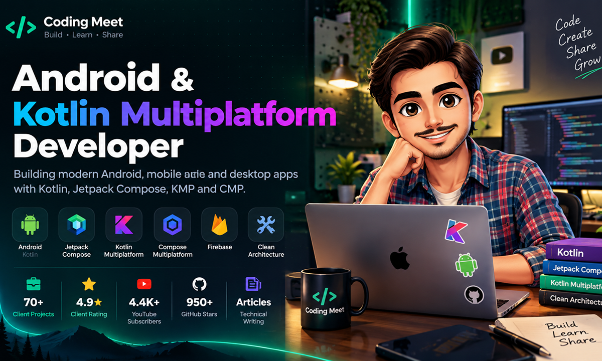

# 🚀 Coding Meet - Modern Developer Portfolio & Showcase

<p align="center">
  
</p>

<p align="center">
  <a href="https://codingmeet.com"></a>
  
  
  
  
</p>

---

## 🌟 Overview

**Coding Meet Portfolio** is an agency-grade personal developer website built with **Kotlin**, **Compose HTML**, and **Kobweb**. Designed with modern glassmorphism, responsive ambient aurora backgrounds, interactive maps, and deep-linking architecture, it highlights production mobile applications, Kotlin Multiplatform software, client services, technical articles, and social proof.

---

## ✨ Key Features & Capabilities

### 📱 1. Production Projects Showcase

- **31+ Comprehensive Projects**: Spanning Android, Kotlin Multiplatform (KMP), Compose Multiplatform (CMP), iOS (Swift), Desktop, and Web.
- **Deep-Linkable Project Dialogs**: Share direct URLs with clients (e.g. `https://codingmeet.com/projects?project=what-event` or `/projects#what-event`) to pop open the project showcase modal directly.
- **Rich Media**: Multi-slide mockups, real device screenshots, YouTube demos, GitHub stars sync, and live store links.
- **Live Categorization**: Instant category filtering (`ALL`, `ANDROID`, `KOTLIN MULTIPLATFORM`, `COMPOSE MULTIPLATFORM`, `DESKTOP`, `WEBSITE`, `IOT`).

### 💼 2. Agency-Style Services Section

- **9 Core Offerings**:
  1. 📱 Custom Android App Development (Clean Architecture + Jetpack Compose)
  2. 🔧 Fix Bugs, Crashes & ANRs
  3. 🚀 Upgrade Android SDK (Target API 35 / Android 15), AGP & Gradle
  4. 🎨 Kotlin & Jetpack Compose UI (XML to Compose migration & Material 3)
  5. 🤖 AI Chatbot & LLM API Integration (Gemini, ChatGPT, Claude, RAG)
  6. ⚡ Kotlin Multiplatform & Compose Multiplatform (KMP & CMP)
  7. 💻 Desktop App Development (macOS, Windows, Linux)
  8. 🍎 Native iOS App Development (Swift & SwiftUI)
  9. 🛡️ Review, Fix & Refactor AI-Generated App Code (ChatGPT / Cursor / Claude)
- **16:9 Aspect Ratio Sliders**: High-definition presentation cards with WebP optimization (>90% file-size reduction).
- **Direct Service Anchors & Live Scroll Spy**:
  - Direct URL access to any service (e.g., `/service#custom-android-app`, `/service#kmp-cmp`, `/service#faq`).
  - Active section scroll spy updates the address bar URL in real time without page reload.
- **Structured Deliverables Grid**: 2×3 feature cards per service highlighting tech deliverables and guarantees.
- **Service Lightbox Modal**: Fullscreen zoomable slide preview with keyboard navigation (Esc, Arrows) and backdrop dismissal.

### 🏆 3. Track Record & Social Proof

- **Milestones**: 4.4K+ YouTube subscribers (450+ tutorials), 950+ GitHub stars, 70+ completed client orders ($9K+ earned, 4.9⭐ rating), 200+ developer community contributions, 60+ Stack Overflow answers, and 1.1K+ Medium claps.
- **Global Client Testimonial Map**: Interactive map with cluster markers visualizing client locations worldwide and interactive country-based reviews modal.

### ❓ 4. Service-Aligned FAQ Accordion

- 12 in-depth questions and answers addressing architecture, Target SDK 35 deadlines, Kotlin Multiplatform vs Flutter, AI code security, and onboarding requirements.

### 🎨 5. Design & Performance

- **Ambient Aurora Glow**: Dynamic SVG gradients and blur filters adapting to Dark and Light modes.
- **Glassmorphism Theme**: Translucent, frosted-glass components with clean borders and subtle shadows.
- **Sticky Navbar with Safe Scroll Offsets**: Smooth scroll navigation with 80px offset preventing headers from being obscured.
- **Lightweight & SEO Ready**: Static site export with pre-rendered HTML and optimized WebP images.

---

## 🛠️ Technology Stack

| Layer                | Technologies                                                                                                              |
| -------------------- | ------------------------------------------------------------------------------------------------------------------------- |
| **Language**         | [Kotlin](https://kotlinlang.org/) (Kotlin/JS)                                                                             |
| **UI Framework**     | [Kobweb](https://github.com/varabyte/kobweb) on top of [Compose HTML](https://github.com/JetBrains/compose-multiplatform) |
| **Design System**    | Material 3 tokens, Silk UI, Custom Glassmorphism, Ambient Aurora                                                          |
| **Interactive Maps** | Leaflet JS, OpenStreetMap, Marker Clustering                                                                              |
| **Hosting & CDN**    | [Firebase Hosting](https://firebase.google.com/products/hosting)                                                          |
| **Asset Formats**    | Modern WebP images, SVG vectors                                                                                           |

---

## 🔗 Direct URL Navigation (Deep Linking)

### Home Page Sections:

- `/#aboutme` - About Me / Hero introduction
- `/#achievement` - Track record, social proof, and milestones
- `/#experience` - Career journey and timeline
- `/#testimonial` - Client reviews and interactive global map
- `/#footer` - Social links and copyright

### Services Page Anchors:

- `/service#custom-android-app` - Custom Native Android Apps
- `/service#fix-bugs` - Bug Fixing & Crash Resolution
- `/service#upgrade-sdk` - Android 15 & Target SDK 35 Upgrade
- `/service#compose-ui` - Jetpack Compose & XML Migration
- `/service#ai-chatbot` - AI Chatbots & LLM Integrations
- `/service#kmp-cmp` - Kotlin & Compose Multiplatform
- `/service#desktop-app` - macOS, Windows & Linux Desktop Apps
- `/service#ios-app` - Native iOS (Swift & SwiftUI)
- `/service#ai-code-review` - Review & Fix AI-Generated Code
- `/service#faq` - Frequently Asked Questions

### Project Direct Links:

- `/projects?project=what-event` - What!Event Showcase Project
- `/projects?project=news-kotlin-multiplatform-app` - News KMP App
- `/projects?project=devanalyzer` - DevAnalyzer Tool
- `/projects?project=pepper-robot-ai-assistant` - Pepper Robot Assistant
- `/projects?project=gemini-ai-kotlin-multiplatform-app` - Gemini AI Multiplatform App

---

## 🚀 Getting Started

### Prerequisites:

- [Java Development Kit (JDK 17+)](https://adoptium.net/)
- [Kobweb CLI](https://kobweb.varabyte.com/docs/getting-started/getting-kobweb)

### Local Development:

```bash
# 1. Clone the repository
git clone https://github.com/Coding-Meet/Porfolio-Kobweb.git
cd Porfolio-Kobweb

# 2. Run the Kobweb dev server
cd site
kobweb run
```

Open [http://localhost:8080](http://localhost:8080) in your browser.

---

## 🚢 Deployment (Firebase Hosting)

```bash
# 1. Build and export static site (automatically injects Open Graph preview tags for all projects, services & blogs)
cd site && kobweb export --layout static

# 2. (Optional) Verify all 56 pages and preview images
cd .. && python3 scripts/verify_images.py

# 3. Deploy to Firebase Hosting
firebase deploy
```

---

## 📬 Connect with Me

- 📺 **YouTube**: [Coding Meet (@CodingMeet26)](https://youtube.com/@CodingMeet26)
- 💼 **LinkedIn**: [Meet](https://www.linkedin.com/in/coding-meet-a74933273/)
- 🌐 **Website**: [codingmeet.com](https://codingmeet.com)
- ✍️ **Medium**: [Stories by Meet](https://medium.com/@meet26)
- 🐦 **X (Twitter)**: [@CodingMeet](https://twitter.com/CodingMeet)
- ☕ **Support**: [Buy Me a Coffee](https://www.buymeacoffee.com/codingmeet)

---

## 📄 License

This project is open-source and available under the [MIT License](LICENSE).
